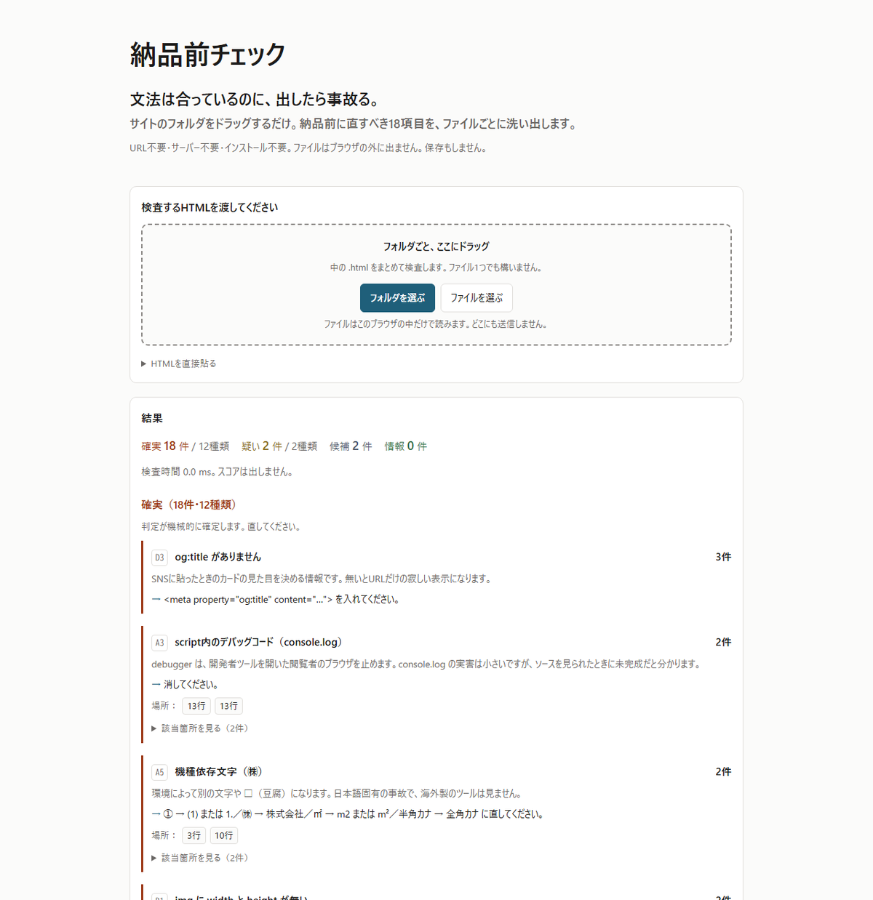

# 納品前チェック

**HTMLを貼るだけで、納品前の事故になる18項目を洗い出します。**

👉 **[kaz-ma.github.io/nouhin-check/](https://kaz-ma.github.io/nouhin-check/)**

---

## なぜ作ったか

Lighthouse、PageSpeed Insights、WAVE、SEOチェキ。どれも優秀ですが、**全部「URL」を要求します。**

**納品前のHTMLは、まだ公開されていません。** ローカルサーバーを立てれば使えますが、毎回それをやりますか。

そして、**文法チェックを通しても事故は防げません。** W3C の Nu Html Checker は「HTMLの仕様に合っているか」だけを見ます。だから次のものは全部通過します。

| 仕様としては正しいHTML | 納品すると何が起きるか |
|---|---|
| 画像のURLが `localhost` のまま | 自分のPCでは最後まで正常に見える。**本番だけ画像が出ない** |
| 本文に「サンプルテキスト」が残っている | 読み慣れた文字列は、自分の目が飛ばす |
| `㈱` や `①` を使っている | 環境によって別の文字や □ になる |
| `img` に `width` と `height` が無い | 読み込み中に、下の文章が飛ぶ |
| https のページで画像だけ `http://` | ブラウザが遮断する。鍵マークが外れる |

**このツールは文法を見ません。「仕様は正しいが、納品すると事故る」18項目だけを見ます。**

## 見る18項目

| 群 | 項目 |
|---|---|
| **A：出したら恥をかくもの** | A1 自分のPCを指すURL／A2 ダミーテキストの残り／A3 デバッグコード／A4 コメント内の作業メモ／A5 機種依存文字 |
| **B：表示が崩れるもの** | B1 `img` の `width`/`height` 欠落／B2 `loading="lazy"` の付け忘れ・付けすぎ／B3 `srcset` が無い `img`／B4 `h1` が0個または2個以上／B5 見出し階層の飛び |
| **C：リンクとフォーム** | C1 ラベルが紐付いていない入力欄／C2 空リンク／C3 混在コンテンツ／C4 `target="_blank"` と `rel="noopener"` |
| **D：検索とSNS** | D1 `title`／D2 `meta description`／D3 `og:title` / `og:image` / `og:description` |

## 使い方

1. **サイトのフォルダごとドラッグ**（中の `.html` をまとめて検査します）。ファイル1つでも、HTMLを直接貼っても構いません
2. 結果が **確実／疑い／候補／情報** の4段階で、**行番号つき**で出ます

**スコアは出しません。**「80点だから大丈夫」という誤った安心を作らないためです。件数と場所だけを出します。

## 確実／疑い／候補 を分けている理由

**誤検出と検出漏れは、重さが違います。**

機械的に判定が確定するものだけを「確実」にしています。`<label>` で囲む形のように、構造上どうしても判定しきれないものは「疑い」に置き、**ツールが断定しません。**

## 仕様

| | |
|---|---|
| ファイル | **単一HTML 1つ**。外部のCSS・JS・フォント・画像を1つも読みません |
| 通信 | **ゼロ。** ファイルはブラウザの外に出ません。保存もしません |
| 動かし方 | `index.html` をダブルクリック。サーバーもインストールも不要 |
| 検査 | 画面の「セルフチェック」から、このツール自身の検査を実行できます |

**文法・閉じタグ・属性の誤りは見ていません。** そこは [W3C Nu Html Checker](https://validator.w3.org/nu/) が無料で、貼り付けにも対応しています。続けて使ってください。

## ライセンス

MIT
